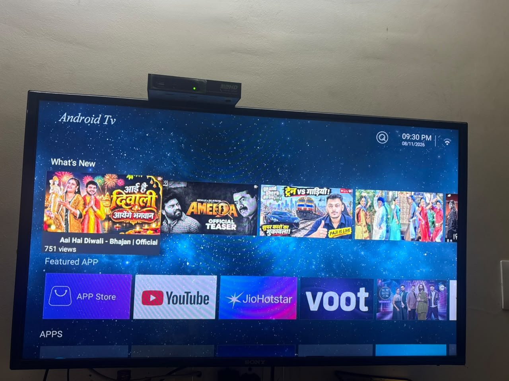
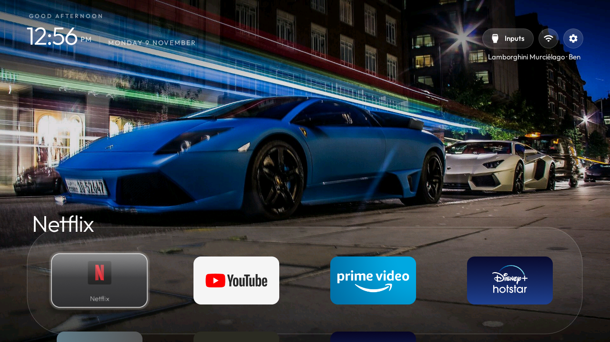
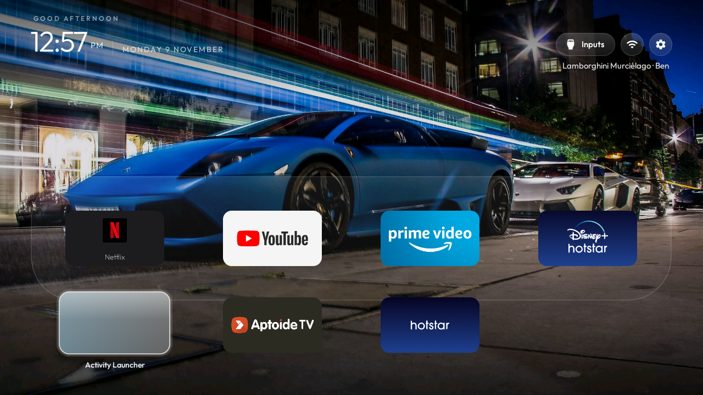
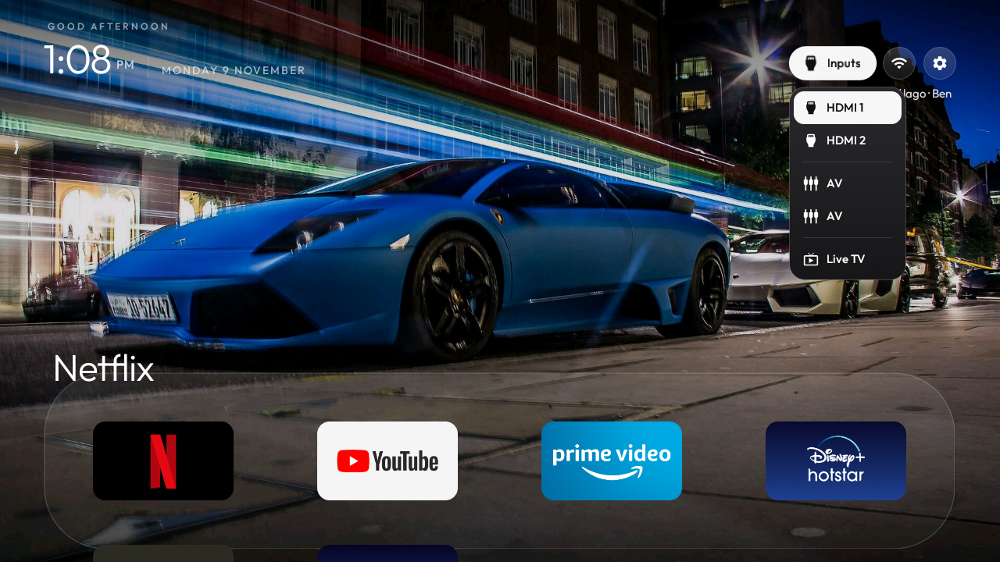
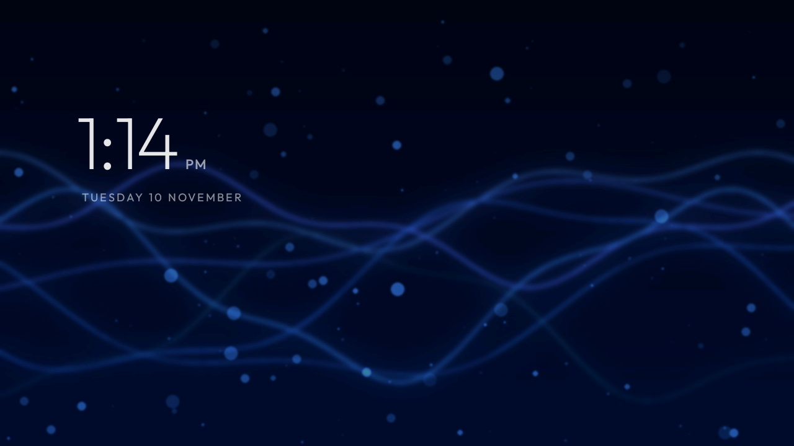

# Smart TV cleanup: clone "Sony" TV → Apple TV style Home

I cleaned up a cheap "Sony"-branded Android TV: removed its ad and tracking apps, replaced its cluttered
launcher with an Apple TV style Home screen, gave it supercar wallpapers and a PS5-style gaming
screensaver, and fixed Netflix, YouTube and Hotstar.

| Before | After |
|---|---|
|  |  |

**The TV:** a clone "Sony" set made by ShenZhen VideoScape (MediaTek mt5862 chip, Android 9, 1 GB RAM,
1.2 GB app storage), running the Zeasn launcher and app store.

## What I did

### 1. Removed ads and trackers
Everything was **disabled, not deleted**, so it can all be switched back on (see `scripts/restore-all.sh`).

| App | What it was |
|---|---|
| `com.android.media.module.services` | Not part of Android: an ad and proxy app with a fake system name, silently installed by Zeasn's service in 2025 |
| `com.zeasn.services.general` | Zeasn ad, weather and search service, starts with the TV |
| `com.zeasn.tv.assistant` | Zeasn "TV Master": watches app installs and the network |
| `com.zeasn.deviceportal.asdprovider.videoscape` | Zeasn ad portal and update checker |
| `cn.zeasn.tv.vstoresubclient.mtk368.videoscape` | Zeasn app store (could install apps silently) |
| `cn.zeasn.launcher.vstoresubclient.videoscape368` | The old Zeasn Home screen |

Lists: [`debloat/`](debloat). Ad-blocking DNS (AdGuard) is also switched on in Android's Private DNS.

### 2. New Home screen
The Apple TV style launcher from [Gathin23/cleanyourtv](https://github.com/Gathin23/cleanyourtv), with
a dock of Netflix, YouTube, Prime Video and Disney+ Hotstar. I changed it for this TV
([`launcher/launcher-changes.patch`](launcher/launcher-changes.patch)):

- **Netflix tile:** this TV's Netflix has no TV-style icon, so the launcher got its own Netflix tile.
- **Live TV in the Inputs menu:** the TV's Live TV app has no normal launcher entry; the launcher now opens
  it another way, so HDMI 1, HDMI 2, AV and Live TV are all in one menu.
- **Separate screensaver pictures:** wallpapers named `clock-*.jpg` show only on the idle clock screen,
  never on Home.

| Home | Inputs menu |
|---|---|
|  |  |

### 3. Wallpapers
- **Home:** six night photos of supercars (Lamborghinis, Porsche 911, Nissan Skyline GT-R), a new one every
  30 minutes, with the car's name and photographer under the buttons.
- **Idle screen:** a clock over PS5-style gaming pictures: three blue, purple and teal light-wave pictures I
  generated, plus photos of a PS5 DualSense, RGB gaming PCs and esports arenas.

| Idle clock screen |
|---|
|  |

Files: [`theme/supercars/`](theme/supercars). Photo credits and licences: [`CREDITS.md`](theme/supercars/CREDITS.md).

### 4. Apps fixed
- **Netflix:** the preinstalled 2016 version could no longer connect, so I updated it to 7.120.
- **YouTube:** updated from 2.10 to 3.01, the newest 32-bit build (newer ones are 64-bit only).
- **Disney+ Hotstar:** updated from 5.1 to 5.3; the old duplicate "Hotstar" app was removed.
- **Aptoide TV:** updated from 5.1.1 to 5.1.3.
- **Why Aptoide's "Update all" kept failing:** app storage was full (81 MB free out of 1.2 GB). I cleared
  the caches and removed Zoom, which wasn't used.

## Repo layout

| Folder | What's inside |
|---|---|
| `screenshots/` | Pictures taken from the TV |
| `debloat/` | The disabled apps, in the batches they were disabled in |
| `launcher/launcher-changes.patch` | My changes to the launcher code |
| `theme/supercars/` | The wallpaper theme: settings, pictures, credits |
| `scripts/` | Undo everything (`restore-all.sh`) and rebuild/install the launcher |
| `docs/technical-notes.md` | Full notes: every command, how to undo things, how to change the dock or wallpapers |

The scripts and the patch are meant to be used inside a copy of
[Gathin23/cleanyourtv](https://github.com/Gathin23/cleanyourtv): copy `scripts/` and `debloat/` into its
`work/` folder, put `theme/supercars/` at `work/supercars/`, and apply the patch with `git apply`.

## Credits and licences
- Launcher and tools: [Gathin23/cleanyourtv](https://github.com/Gathin23/cleanyourtv) (MIT licence). The patch
  modifies that code.
- Supercar and gaming photos: Wikimedia Commons, under CC BY / CC BY-SA. Photographers and links are in
  [`theme/supercars/CREDITS.md`](theme/supercars/CREDITS.md).
- The three light-wave screensaver pictures are original and free to use (CC0).
